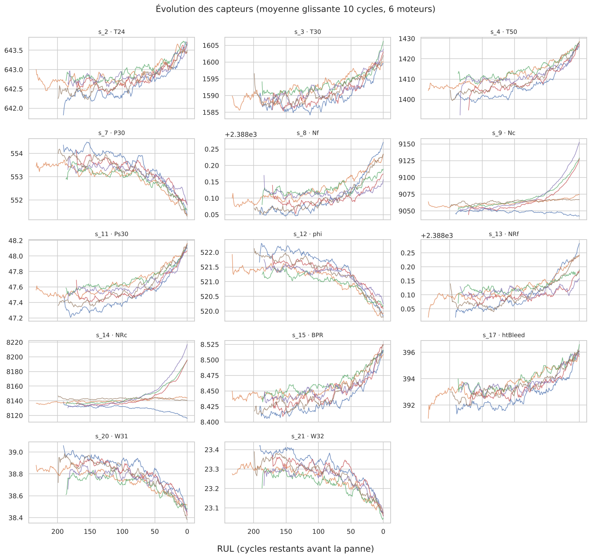

# Maintenance prédictive de turboréacteurs (NASA C-MAPSS)

Prédire la **durée de vie restante** (*Remaining Useful Life*, RUL) de moteurs d'avion à partir de leurs capteurs, pour planifier la maintenance **avant la panne** plutôt qu'à intervalle fixe.

> 🚧 Projet en cours : exploration terminée, modélisation en préparation.

## Contexte

En maintenance préventive classique, on révise un équipement à date fixe, qu'il soit usé ou non. La maintenance prédictive lit l'**état réel** de la machine dans ses données capteurs et prévoit le moment de la panne. Résultat : moins d'arrêts imprévus et moins d'interventions inutiles.

Ce projet applique la démarche que j'utilise en alternance dans l'industrie (analyse de signaux, indicateurs de dérive, détection d'anomalies) à un jeu de données public de référence.

## Données

NASA C-MAPSS (*Turbofan Engine Degradation Simulation*, NASA Prognostics Center of Excellence), sous-ensemble **FD001** :
- 100 moteurs d'entraînement suivis jusqu'à la panne, 100 moteurs de test arrêtés avant la panne
- 21 capteurs (températures, pressions, vitesses, débits) et 3 réglages de fonctionnement, mesurés à chaque cycle
- une condition de vol, un mode de panne (dégradation du compresseur haute pression)

## Premiers résultats de l'exploration



- Les durées de vie vont de **128 à 362 cycles** : une révision à date fixe serait soit trop tôt, soit trop tard.
- **9 colonnes sont (quasi) constantes** et sont retirées : il reste **14 capteurs utiles**.
- La dégradation s'accélère nettement dans les **~50 derniers cycles** : la RUL sera plafonnée à ~125 cycles pour l'entraînement.
- Les capteurs les plus liés à la RUL : pression statique HPC (s_11), température LPT (s_4), ratio carburant (s_12), pression HPC (s_7).

## Démarche

| Étape | Notebook | Statut |
|---|---|---|
| Exploration des données | `01_exploration.ipynb` | ✅ |
| Indicateurs sur fenêtres glissantes | `02_features.ipynb` | ⏳ |
| Modélisation (régression linéaire → Random Forest / XGBoost) | `03_modelisation.ipynb` | ⏳ |
| Règle de décision maintenance (seuil d'alerte, coût des erreurs) | `04_decision.ipynb` | ⏳ |

## Structure

```
├── data/download_data.py   # téléchargement des données
├── notebooks/              # analyses pas à pas
├── src/data.py             # chargement et préparation réutilisables
└── reports/figures/        # graphiques exportés
```

## Lancer le projet

```bash
python -m venv .venv && source .venv/bin/activate   # Windows : .venv\Scripts\activate
pip install -r requirements.txt
python data/download_data.py
jupyter notebook notebooks/01_exploration.ipynb
```

## Stack

Python · Pandas · NumPy · Matplotlib · Seaborn · scikit-learn

## Auteure

**Lesly Ngounou Biega**, Data Analyst / Data Engineer (alternance, industrie automobile) · élève ingénieure Big Data à l'ESIGELEC
[LinkedIn](https://www.linkedin.com/in/lesly-ngounou-biega) · [GitHub](https://github.com/NB-Lesly)
